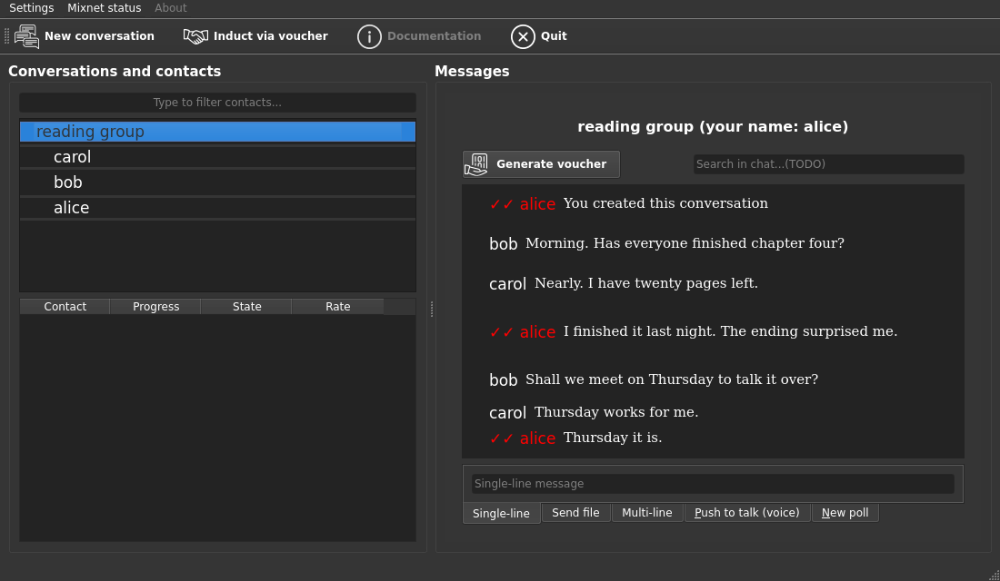

# katzenqt

[](https://github.com/katzenpost/katzenqt/actions/workflows/pytest.yml)

katzenqt is a desktop group chat client for the [Katzenpost](https://katzenpost.network)
mixnet. It reaches the mixnet through the client daemon
[kpclientd](https://github.com/katzenpost/katzenpost/tree/main/cmd/kpclientd), and it can
also be driven from the command line without its Qt interface. This README is for
people who want to run it or work on it.

People join a group by exchanging [contact vouchers](spec/contact-vouchers.md). It is
a client for developing and testing group chat on the mixnet, not a messenger for
daily use; see the warning below. To script a client instead, use the [headless CLI](docs/headless.md).



## Quick start

There are no release packages yet. On Debian or Ubuntu, build from source:

```shell
sudo apt install -y git make
git clone https://github.com/katzenpost/katzenqt ~/katzenqt
cd ~/katzenqt
make deps
make run
```

If `sudo` refuses you, run `su -c 'apt install -y git make'` instead.
On NixOS, or with Nix on any Linux, see [Building with Nix](docs/building.md#nix).

katzenqt needs kpclientd running. `make deps` installs the system packages and the
Python venv, runs the tests, builds kpclientd from a pinned
[katzenpost](https://github.com/katzenpost/katzenpost) checkout, and starts it as a user
service that connects to the namenlos mixnet. `make status` shows whether it is active;
[Building](docs/building.md) takes the steps one at a time.

## Docs

[Building](docs/building.md), [Running](docs/running.md),
[Headless CLI](docs/headless.md), [Testing](docs/testing.md),
[Packaging](docs/packaging.md), [Hacking](docs/hacking.md), and the
[Tally API](docs/tally-api.md) and [how-to](docs/tally-howto.md) for polls and votes.
The [group chat design](https://katzenpost.network/docs/specs/groupchat/) and
[thin client spec](https://katzenpost.network/docs/specs/thinclient/) are on the website.

## Map

- [src/katzenqt/](src/katzenqt): the Qt client; `katzen.py` is the main window
- [src/katzenqt/groupchat/](src/katzenqt/groupchat): a model of the group chat
  protocol, with no Qt, database or network
- [src/katzenqt/tally/](src/katzenqt/tally): polls and votes over a conversation
- [src/katzenqt/headless/](src/katzenqt/headless): the `katzenqt-headless` CLI
- [tests/](tests): unit tests; [tests/integration/](tests/integration) needs a mixnet
- [debian/](debian) and [packaging/](packaging): Debian and Flatpak packaging

## Status

Version 0.0.3, Python 3.11 or later. katzenqt reads wire versions 3 and 4 of its
group chat messages and writes version 4 unless told to write 3. It uses thin client
0.0.25 and builds kpclientd from the katzenpost revision pinned in the [Makefile](Makefile). The vectors
in [tests/data/](tests/data) fix the wire format and the voucher format.

## Testing and contributing

`make test` runs the unit tests; [Testing](docs/testing.md) covers the rest. Send
changes as pull requests on GitHub; [Hacking](docs/hacking.md) explains the layout.

katzenqt is part of the [Katzenpost](https://github.com/katzenpost) organization.

## Warning

DO NOT USE THIS SOFTWARE UNLESS YOU ARE DEVELOPING IT AND AWARE OF THE TECHNICAL
RISKS. DO NOT RELY ON THIS SOFTWARE FOR ANONYMITY, SECURITY, PRIVACY,
RELIABILITY, RESILENCY, CREDIBILITY, FRIENDSHIP, FUN, OR ANY SERIOUS BUSINESS.

## License

Public domain, as declared in [pyproject.toml](pyproject.toml), except
`src/katzenqt/theme.py`, which is AGPL-3.0-only; see [debian/copyright](debian/copyright).
